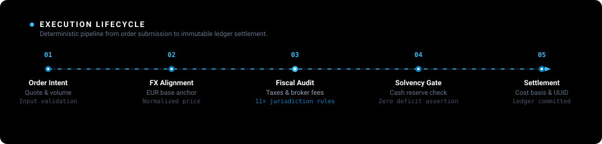

<p align="center">
  
</p>

<p align="center">
  
</p>

<p align="center">
  
</p>

## Overview

NovaEngine is an open-core, headless simulation runtime for quantitative trading, market data ingestion, portfolio accounting, and multi-jurisdiction fiscal auditing.

This repository is directly based on the core mechanics and financial calculation engine of the **NovaTrade** application and its official web deployment at [https://portfolio.raulsalas.com/novatrade-web/](https://portfolio.raulsalas.com/novatrade-web/).

In the same manner that Chromium serves as the decoupled, GUI-independent engine underpinning modern web browsers, NovaEngine provides the underlying financial mechanics and execution logic for trading simulators, quantitative backtesters, and fintech frontends without coupling to any graphical user interface framework.

All visual components, widget trees, and proprietary credentials have been eliminated. What remains is a deterministic, high-throughput financial calculation core implemented natively in both **Dart** and **Python**.

<p align="center">
  
</p>

## Architectural Topology

NovaEngine isolates market ingestion, currency harmonization, statutory fiscal calculations, and position accounting into specialized, loosely-coupled subsystems.

<p align="center">
  
</p>

### Core Design Principles

- **Zero Graphical Overhead**: Pure mathematical and logical contracts. NovaEngine runs equally well in serverless backends, automated cron jobs, command-line scripts, or embedded inside Dart and Python clients.
- **Strict Credential Sanitization**: No hardcoded API keys, client secrets, or private personal identifiers. External services rely on public endpoints or runtime client parameter injection.
- **Canonical Currency Harmonization**: All internal portfolio valuations, tax withholdings, and historical acquisition costs are grounded in a canonical EUR base to eliminate foreign exchange drift across multi-asset holdings.
- **Comprehensive Regulatory Tax Auditing**: Real-world transactions are not frictionless. NovaEngine computes statutory national transaction taxes (Tobin Tax, SDRT, TTF, SEC Section 31 fees), exchange execution canons, brokerage commissions, and progressive capital gains withholdings.

<p align="center">
  
</p>

## Execution Lifecycle

When an order is submitted to NovaEngine, it passes through a multi-stage validation and settlement pipeline.

<p align="center">
  
</p>

1. **Order Intent Verification**: Validates asset identifiers, direction (buy/sell), positive volume, and live quote availability.
2. **FX Currency Harmonization**: Normalizes quotes from the asset's trading currency into the investor's tax jurisdiction currency.
3. **Fiscal and Regulatory Audit**: Evaluates broker commission floors, exchange settlement canons, national transaction duties, and progressive capital gains withholding.
4. **Solvency Verification**: Guarantees that sufficient cash reserves are present before committing the purchase, preventing negative balance anomalies.
5. **Settlement and Ledger Commit**: Updates position quantity, recalculates the weighted average acquisition cost, debits or credits net cash, and generates an immutable UUID audit receipt.

<p align="center">
  
</p>

## Key Subsystems

### 1. Multi-Jurisdiction Tax and Regulatory Engine
NovaEngine implements official statutory fiscal calculations across major international jurisdictions:

| Jurisdiction | Tax Authority | Transaction Duty | Baseline Capital Gains | Regulatory Details |
| :--- | :--- | :--- | :--- | :--- |
| Spain | AEAT / Hacienda | 0.20% (Tobin Tax Ley 5/2020) | 19.0% to 28.0% | Official progressive savings brackets (IRPF Base del Ahorro) + BME canons |
| United States | IRS & SEC | SEC Section 31 fee | 15.0% to 20.0% | Federal capital gains benchmarks and FINRA Trading Activity Fee (TAF) |
| United Kingdom | HMRC | 0.50% (SDRT Stamp Duty) | 20.0% | Statutory Stamp Duty Reserve Tax on equity purchases |
| France | DGFiP | 0.30% (TTF Art. 235 ter ZD) | 30.0% | Taxe sur les Transactions Financieres + Flat Tax PFU |
| Germany | BZSt / Finanzamt | Exchange Canon | 26.38% | 25% Abgeltungsteuer plus 5.5% mandatory solidarity surcharge (Soli) |
| Italy | Agenzia delle Entrate | 0.10% (Tobin Tax) | 26.0% | Regulated market transaction tax plus substitute tax on net gains |
| Portugal | Autoridade Tributaria | 4% on commissions | 28.0% | Autonomous IRS capital gains rate under CIRS Art. 72 |
| Sweden | Skatteverket | Exchange Canon | 30.0% | State tax on realized capital gains within conventional custody |
| Netherlands | Belastingdienst | Exchange Canon | 32.0% | Box 3 wealth yield taxation applied to investment returns |
| Finland | Verohallinto | Exchange Canon | 30.0% to 34.0% | Progressive capital income tax: 30% up to 30,000 EUR, 34% on excess |
| Switzerland | ESTV / AFC | 0.15% (Federal Stamp Duty) | 0.0% | Turnover duty with capital gains tax exemption for private individuals |

### 2. Market Data Providers
- **Yahoo Finance Connector**: Fetches equities, ETFs, and indices via public query endpoints with short-duration in-memory caching (10 seconds for spot quotes, 5 minutes for search and historical candles).
- **CoinGecko Connector**: Fetches cryptocurrency spot rates, market capitalization rankings, and 24-hour volume metrics.
- **Offline Resilience Fallbacks**: Both connectors maintain pre-warmed offline benchmarks, guaranteeing deterministic test execution and continuous offline operation.

### 3. Multi-Currency FX Engine
- Canonical EUR base anchor.
- Direct and cross-currency conversion matrices across 10 global fiat currencies: EUR, USD, GBP, JPY, CHF, CAD, AUD, SEK, MXN, and BRL.
- Live background synchronization via open exchange rate endpoints with graceful offline fallback matrices.

### 4. Storage and Persistence
- **Atomic JSON Store**: File-based persistence utilizing sibling temporary file swaps to guarantee atomic writes and prevent file corruption during sudden termination.
- **SQLite Relational Store**: Embedded relational database maintaining tables for metadata, active positions, and an immutable transaction ledger.

### 5. Quantitative Analytics
- Net account profit and loss tracking.
- Win/loss ratio and profit factor analysis across historical trades.
- Peak-to-trough maximum drawdown tracking.
- Cumulative fee and tax friction audit reporting.

<p align="center">
  
</p>

## Installation

### Dart Runtime
```bash
git clone https://github.com/raulsalas/NovaEngine.git
cd NovaEngine
dart pub get
```

### Python Runtime
```bash
git clone https://github.com/raulsalas/NovaEngine.git
cd NovaEngine
pip install -r requirements.txt
pip install -e .
```

<p align="center">
  
</p>

## Quickstart

### Command-Line Interface

NovaEngine ships with identical command-line tooling implemented natively in both Dart and Python.

#### Dart CLI Executable

```bash
# Query a stock or ETF quote
dart run bin/novaengine.dart quote AAPL

# Query a cryptocurrency quote
dart run bin/novaengine.dart crypto bitcoin

# Execute a stock purchase in Spain (evaluating Tobin tax and broker fees)
dart run bin/novaengine.dart buy AAPL 10 --price 228.45 --country ES

# Execute a cryptocurrency purchase
dart run bin/novaengine.dart buy bitcoin 0.5 --crypto --country ES

# Execute a sale with progressive capital gains tax withholding
dart run bin/novaengine.dart sell AAPL 5 --price 250.00 --country ES

# Print the portfolio statement and balance breakdown
dart run bin/novaengine.dart statement

# View statutory tax parameters across supported jurisdictions
dart run bin/novaengine.dart taxes
```

#### Python CLI Executable

```bash
# Query a stock or ETF quote
python -m novaengine.cli quote AAPL

# Query a cryptocurrency quote
python -m novaengine.cli crypto bitcoin

# Execute a stock purchase in Spain (evaluating Tobin tax and broker fees)
python -m novaengine.cli buy AAPL 10 --price 228.45 --country ES

# Execute a cryptocurrency purchase
python -m novaengine.cli buy bitcoin 0.5 --crypto --country ES

# Execute a sale with progressive capital gains tax withholding
python -m novaengine.cli sell AAPL 5 --price 250.00 --country ES

# Print the portfolio statement and balance breakdown
python -m novaengine.cli statement

# View statutory tax parameters across supported jurisdictions
python -m novaengine.cli taxes
```

<p align="center">
  
</p>

### Programmatic Core APIs

Both implementations share identical financial mechanics, accounting rules, and tax equations.

#### Dart Core API

```dart
import 'package:novaengine/novaengine.dart';

void main() async {
  // Initialize the headless simulation engine
  final engine = NovaSimulationEngine(
    cashBalance: 50000.0,
    userCountry: 'ES',
  );

  // Execute equity purchase with Spanish Tobin tax (Ley 5/2020) and broker fees
  final buyReceipt = await engine.buy(
    assetId: 'AAPL',
    assetName: 'Apple Inc.',
    assetType: 'stock',
    quantity: 10.0,
    pricePerUnit: 228.45,
  );

  print('Buy Receipt ID: ${buyReceipt?.id}');
  print('Gross Cost: €${buyReceipt?.grossAmount.toStringAsFixed(2)}');
  print('Broker Commission: €${buyReceipt?.brokerCommission.toStringAsFixed(2)}');
  print('Tobin Tax: €${buyReceipt?.tobinTax.toStringAsFixed(2)}');
  print('Remaining Cash: €${engine.cashBalance.toStringAsFixed(2)}');

  // Liquidate a portion of the position at higher market valuation
  final sellReceipt = await engine.sell(
    assetId: 'AAPL',
    quantity: 5.0,
    pricePerUnit: 260.00,
  );

  print('Sell Receipt ID: ${sellReceipt?.id}');
  print('Realized Capital Gain: €${sellReceipt?.capitalGain.toStringAsFixed(2)}');
  print('Capital Gains Tax Withheld: €${sellReceipt?.taxWithheld.toStringAsFixed(2)}');
  print('Net Proceeds Credited: €${sellReceipt?.netProceeds.toStringAsFixed(2)}');

  // Generate complete valuation statement
  final statement = engine.getStatement();
  print('Current Net Worth: €${statement['totalNetWorth']}');
  print('Cash Reserve: €${statement['cashBalance']}');
}
```

#### Python Core API

```python
from novaengine import NovaEngine, AssetType
from novaengine.storage import JsonStorageProvider

# Initialize the headless engine with atomic persistence
storage = JsonStorageProvider("portfolio.json")
engine = NovaEngine(
    country_code="ES",
    initial_capital=100000.0,
    storage_provider=storage,
)

# Execute an equity purchase (automatically calculates broker fees & Tobin tax)
buy_receipt = engine.buy(
    asset_id="AAPL",
    quantity=20.0,
    price_per_unit=228.45,
    asset_name="Apple Inc.",
    asset_type=AssetType.STOCK,
)
print(f"Buy Order Status: {buy_receipt.status}")
print(f"Total Settled Outlay: €{buy_receipt.net_amount:.2f}")

# Liquidate a portion of the position at a higher market price
sell_receipt = engine.sell(
    asset_id="AAPL",
    quantity=10.0,
    price_per_unit=260.00,
    asset_type=AssetType.STOCK,
)
print(f"Sell Order Status: {sell_receipt.status}")
print(f"Capital Gains Tax Withheld: €{sell_receipt.capital_gains_tax:.2f}")
print(f"Net Cash Credited: €{sell_receipt.net_amount:.2f}")

# Inspect comprehensive portfolio metrics
statement = engine.get_statement(currency_code="EUR")
print(f"Current Net Worth: €{statement['total_net_worth']:,.2f}")
print(f"Total Return: {statement['total_profit_loss_pct']:+.2f}%")
```

<p align="center">
  
</p>

## Testing

Both runtimes feature comprehensive unit test suites covering statutory fiscal schedules, foreign exchange harmonization, solvency safeguards, and transaction order lifecycles:

### Dart Test Suite

```bash
dart test
```

### Python Test Suite

```bash
# Standard library test runner
python3 -m unittest discover tests

# Or with pytest
pytest
```

<p align="center">
  
</p>

## License and Terms of Use

NovaEngine is released under the **NovaEngine Source Reciprocal and Contribution License**.

### Mandatory Reciprocal Upstream Requirement
Any modification, enhancement, bug fix, or extension made to NovaEngine must be contributed back to this official repository via pull request. Retaining private modifications, creating closed-source derivatives, or maintaining private forks for separate usage without upstream contribution is strictly prohibited.

### Commercial and Unrestricted Use Authorization
Any use of the software for independent, commercial, proprietary, uncredited, or unrestricted distribution outside these reciprocal contribution terms requires prior written authorization from the creator:

- **Creator**: Raúl Salas Sahuquillo
- **Email**: raulsalassahuquillo.dev@gmail.com

Review the complete legal text in the [LICENSE](LICENSE) file.

<p align="center">
  
</p>

## Contributing and Security

- For contribution workflows, coding guidelines, and pull request requirements, see [CONTRIBUTING.md](CONTRIBUTING.md).
- For security policies and vulnerability disclosure procedures, see [SECURITY.md](SECURITY.md).
